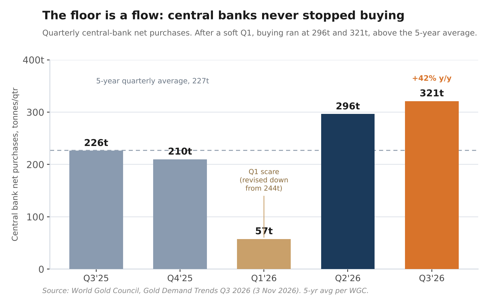
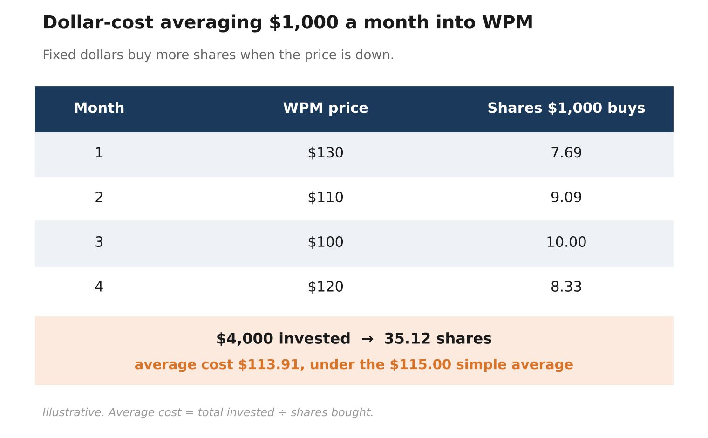

# How I'm Actually Buying the Gold Thesis

### Gold just printed a fresh 2026 low. Here's why I'm buying it on a schedule instead of waiting for a bottom, and the arithmetic behind that.

Gold is at $3,670 as I write on November 19, a fresh 2026 low. It is down 35% from January's $5,626 peak and 19% from where it sat when I last wrote in September. A few readers asked whether that breaks the thesis. It doesn't, and this post is about what I'm doing with the weakness instead.

**The short version**

- The floor under gold isn't a price, it's a flow: the pace of price-insensitive central-bank buying, which has run about 885 tonnes over the last four quarters. A lower spot doesn't stop the buying.
- A thesis with no price target can't tell you the day to buy. Dollar-cost averaging fits that shape: fixed dollars on a fixed schedule, more shares when the price is down.
- The math is small and real. DCA gives you the harmonic mean of your purchase prices, about 1% under the simple average in a volatile year. It does nothing for the risk I picked the wrong vehicle, and price is still not a break condition.
- I hold Wheaton Precious Metals and add on a fixed monthly schedule. The break conditions and where they stand are at the bottom.

## The floor is a flow, not a price

$3,670 looks like a problem for a rising-floor thesis, so let me sharpen what the floor is. In [June](https://darrenleung1.substack.com/p/gold-fell-28-central-banks-bought) and [September](https://darrenleung1.substack.com/p/the-current-thesis-on-gold) I called it a rising floor, and I always meant it structurally: a bid that ratchets higher over years, never a line spot couldn't fall through. A 35% drawdown is a good reason to say that precisely. The floor is a flow, the pace of price-insensitive central-bank demand, and a flow doesn't hold a price level from one quarter to the next. What it does is keep a bid under the market that shows up regardless of the tape, and lift the level the price works back toward over years.

That flow is intact. Central banks bought a provisional 321 tonnes in Q3, above Q2's 296 and the five-year average of 227. Single quarters get revised hard here, Q1 went from 244 to 57, so I lean on the trailing four-quarter sum, about 885 tonnes, which a lone revision barely dents. Year to date is 675 tonnes, 6% ahead of last year. And it's funded the way September laid out: foreign official holders cut their Treasury holdings by $164 billion over the year to August, China's own reported holdings fell $109 billion, and the PBoC added gold every month. None of that moved when the price fell. The financial layer marked gold down; the structural bid kept buying underneath.

*Quarterly central-bank net purchases. After a soft Q1 (since revised down to 57t), buying ran 296t and 321t, above the 227t five-year average. Source: WGC Gold Demand Trends Q3 2026.*

So the flow didn't stop the drawdown, and I'm not going to pretend it did. Here's the test I'll hold myself to instead. If the buying pace holds above 800 tonnes a year and gold is still trading below its 200-week moving average, at $3,000 today, when the WGC publishes Q2 2027 demand, then the flow is doing less for the price than I'm claiming. That's not a price target, it's the long-term trend line, and I'll re-read it against the rate path each quarter. It stands no matter what the Fed does, and it's in the ledger at the bottom.

## What's pushing the price down

The price above that floor is set by rates, and rates are moving the wrong way for gold. The Fed resumed hiking in September, a quarter point to a 3.75 to 4.00% range. The market has December all but priced and leans toward 4.5 to 4.75% by mid-2027. The 10-year Treasury yield is back near 5% and the 30-year near 5.4%. Higher rates raise the cost of holding something that yields nothing, and the financial layer sells gold on exactly that. The WGC pinned October's drop on the same causes: "Fed rate-path repricing, speculative de-grossing," and a rotation into bonds. Some of it was plain risk-off: gold fell in the same weeks the S&P and Nasdaq did, and when everything drops at once the most liquid assets get sold first to raise cash, gold among them. That kind of forced selling is noise, not a verdict on the metal, and you can't time it. It's a reason to buy on a schedule, not to wait.

Rates still move gold, and right now they move it down. Gold fell hard early in the 2022 hiking cycle, about 21% from its March 2022 high into that autumn, the old relationship working as advertised. What the old rule can't carry is the leg after. The Fed held at 5.25 to 5.50% from mid-2023 to late 2024, a two-decade high, and gold rose about 32% across that hold, from roughly $1,950 to $2,560, before a single cut. It kept climbing after, to new highs above $5,000 by January 2026, with the 10-year real yield above 2% the whole way, past the level that is supposed to cap it. Part of that later leg was the market pricing cuts, which is fair, but high rates were meant to pin gold from the start and didn't. The bid that cleared the supply was central banks. [My June post](https://darrenleung1.substack.com/p/gold-fell-28-central-banks-bought) made that case in full.

That also says where the next leg up comes from, and it's a view, not a fact. The flow is the floor; the lift, I think, comes when the Fed turns, and it turns when inflation cools, so I've put CPI and oil on the ledger as things to watch. The turn isn't here, the Fed is still hiking, and that's exactly why the entry is a schedule and not a single bet. One honest flag: that view is also an escape hatch, since I could always say the floor holds and gold is just waiting on the Fed. It doesn't void the test above. If the buying holds and gold keeps making lower lows into mid-2027, I was wrong, Fed or no Fed.

## On the 2011 comparison

You'll see this one everywhere right now: gold fell about 44% over the three years after its 2011 peak, paste that onto this cycle and you land near $3,000, which happens to be where my floor test sits anyway. But the setup is the mirror image, and rates are why. In 2011 the Fed had been pinned at zero, 0.13%, since the 2008 crisis, with nowhere to go but tighter, and that is what ground gold down for four years: real yields normalized up off the floor, the 2013 taper tantrum above all, before the Fed even lifted off in December 2015. Today the funds rate is 3.88% and restrictive, with room to ease once inflation cools. 2011 had the rate headwind ahead of it; today, past the near-term hiking, has the tailwind.

The buyer flipped too. In 2011 the marginal buyer was price-sensitive, Western ETFs and macro funds, so when the price broke they sold into it and the fall fed on itself. Now it's price-insensitive central banks, who bought through this year's drop. Same chart shape, opposite buyer. This decline is also faster, about 35% in ten months against three years, and it came alongside an equity sell-off, the liquidation above rather than a slow bleed. The full 2011-versus-today table, real yields, the dollar, the pace of official buying, is in my June and September posts.

## You can't limit-order a floor you won't price

Both prior posts refused a price target, on purpose. Gold has no cash flows, so every target I've seen is someone backing into a number from a monetary ratio and calling it precision. If I can't tell you whether gold bottoms at $3,857 or $3,400, I can't tell you the single day to buy. A limit order needs a level. I don't have one. What's left is to buy a fixed amount on a fixed date and let the schedule set the entry.

## The arithmetic

Dollar-cost averaging means investing the same dollar amount on a schedule regardless of price. The fixed dollar buys more shares when the price is low and fewer when it's high.

Here's $1,000 a month into WPM across four months of the kind of swing it actually produces.

You put in $4,000 and own 35.12 shares, a cost basis of $4,000 ÷ 35.12 = $113.91. The simple average of the four prices is $115.00. You came in $1.09 under, about 1%.

That gap isn't luck. Because the fixed dollar buys more shares when WPM is cheap, your average cost gets pulled toward the low prices, so it lands at or below the simple average every time. The two are equal only if the price never moves. More volatility, bigger gap, so WPM's swings make it larger than it would be on a sleepy stock. Over a full year it's worth maybe 1% to 3% on the cost basis. A tailwind on the entry, not an edge on the thesis.

One caution on what the arithmetic proves. The harmonic mean is a fact about the prices I paid. It is not a claim that spreading the money out beats putting it all in today, which depends on what gold does next.

## Where DCA helps, and where it doesn't

DCA is a confession that I can't time the bottom. If I knew gold ran straight up from here, a lump sum today would beat it, and historically lump sum beats DCA more often than not, because markets rise more than they fall. DCA earns its keep when the price chops or falls before it recovers, which is close to where the WGC's own floor framework puts us. It looks for three things before calling an interim bottom: gold stretched well below its 200-day average, a sharp dollar rally, and a washout in speculative futures positioning. The first two are here; the positioning washout isn't, which it reads as more downside likely before the turn. That's the environment averaging in is built for.

It smooths the price I pay. It does nothing about whether I bought the right thing. Everything in the first post about owning the streamer still applies: WPM carries its mining partners' execution risk, a disruption at Antamina, a partner default, a shift in capital allocation under new management. Spreading my buys across four months dilutes when I buy, not what I bought.

And price is not a break condition. The break conditions belong to the thesis, and here's where they stand.

## Break conditions

Rules 1 and 2 are commitments from my June and September posts. Rules 3 to 6 are new. This is the first time I've set the gold thesis out as a ledger, so from here I carry every rule forward word for word. Price is never one of them.

1. **Central-bank demand.** Full-year 2026 below 800 tonnes. Set June 2026, with Q3 as the checkpoint. Action: the structural bid is normalizing, stop adding. Not triggered. 675 tonnes through nine months, Q4 needs about 125 to clear, and Q2 and Q3 each ran near 300; the trailing four quarters already sum to about 885.

2. **Reserve-funding mix.** The next WGC survey shows the share of central banks funding gold by selling other reserves rising materially above 38%. Set June 2026. Action: review, the buyer is working harder to fund the same trade. Not triggered, and no new survey until mid-2027.

3. **Treasury long-end buybacks.** The November refunding scales the long-end "liquidity support" operations back toward the old $2 billion per operation. Set November 2026. Action: review, fiscal stress easing. Not triggered, and it went the other way: the quarter's planned buybacks rose to up to $70 billion from $38 billion, the per-operation cap to $6 billion.

4. **China's Treasury rundown.** China halts its Treasury sales, or the PBoC stops adding gold. Set November 2026. Action: review, the feedback loop is breaking. Not triggered. China's holdings fell $109 billion year on year to August; the PBoC added 26 tonnes in October, its 24th straight month.

5. **The floor test.** Buying holds above 800 tonnes a year but gold is still below its 200-week moving average, about $3,000 today, when the WGC publishes Q2 2027 demand. Set November 2026. Action: I was wrong, the flow does less for the price than I claim. Pending, graded mid-2027. This is the one that actually falsifies the floor.

6. **Inflation path.** CPI reaccelerates or oil spikes and pushes the Fed's turn further out. Set November 2026. A watch, not a break: it moves the timing of the upside, not whether the floor holds.

One correction to log: my September post put Q2 demand at 289 tonnes; the Q3 report revised it to 296.

What would move you off gold faster: central banks slowing their buying, or the price grinding lower while they don't? I'd like to know which one you're watching.

## A note on the vehicle

I buy WPM, not the metal, and that choice deserves its own scrutiny. A streamer gives you gold-price leverage plus contracted volume growth, but it also carries a multiple and a share price's moods, so entry matters more here than it does for bullion. Why I own WPM and not the miners or the other streamers, how it has traded against gold and silver through this drawdown, and whether the market is paying up for it, is a post of its own. It's coming within the month.

## The close

I still can't tell you where the floor is in dollars, because it isn't a dollar figure. It's a bid that's bought about 885 tonnes over the last year, and it's still buying. A price I won't name isn't a price I can wait for. So I'm not waiting. I'm buying the same slice on the same day every month, and letting the schedule do the part I can't.

---

**Disclosure.** I hold a position in Wheaton Precious Metals and add to it on a fixed monthly schedule. This is for information, not investment advice. Dollar-cost averaging reduces the impact of entry timing; it does not reduce the risk of the position, does not beat a lump sum in a rising market, and does not guarantee a profit.

**Sources.**

- Central-bank demand and the five-year average: World Gold Council, Gold Demand Trends Q3 2026, November 3, 2026. Q1 revised to 57t (57.7t in the quarterly table), Q2 296t, Q3 a provisional 321t, year to date 675t; the trailing four quarters (Q4 2025 through Q3 2026) are 210, 57, 296 and 321, about 885t; five-year quarterly average 227t; the +42% y/y is against Q3 2025's 226t.
- The two pre-registered rules (full-year central-bank demand above 800t, and the 38% reserve-funding metric): my June and September posts.
- Floor framework and the "rate-path repricing" quote: WGC, "Gold Market Commentary: Where floor art thou?", November 5, 2026.
- Treasury buybacks: US Treasury Quarterly Refunding Statements, August 5, 2026 (sb0590, "up to $38 billion… for liquidity support") and November 4, 2026 (sb0678, "up to $70 billion"); "Treasury Announces Increased Sizes of Nominal Long-End Liquidity Support Buybacks," August 19, 2026 (sb0607, "$2 billion per operation will be at least $4 billion"); Tentative Schedule of Treasury Buyback Operations, November 2026 Quarterly Refunding ($6 billion long-end per-operation maximum).
- Treasury holdings: US Treasury TIC Table 5, to August 2026. Foreign official −$164bn year on year; China's total reported holdings −$109bn over the same window (a separate line, not a subset). PBoC buying: WGC China update, November 17, 2026.
- Rates: September hike from the FOMC, September 17, 2026 (+25bp to the 3.75–4.00% range); 10-year and 30-year yields from CNBC/Tradeweb, November 2026; expected Fed path from CME FedWatch, November 2026. The 2011 comparison: fed funds was 0.13% at the September 2011 gold peak (ZIRP from December 2008, held to the December 2015 liftoff) versus 3.88% today, from the US fed funds target rate.
- Gold price history: drawdown bases (January peak $5,626, September $4,527) from COMEX front-month, consistent with my June and September posts; the 2023–24 hold at 5.25–5.50% (gold roughly $1,950 to $2,560, about +32%) and the run above $5,000 by January 2026 with the 10-year real yield still above 2%, from LSEG XAU spot, the US fed funds target rate and my June post; 200-week moving average about $3,000 from LSEG XAU spot; author's calculations.
- Prices: COMEX front-month gold about $3,670 and WPM about $117 (NYSE close), November 19, 2026.
