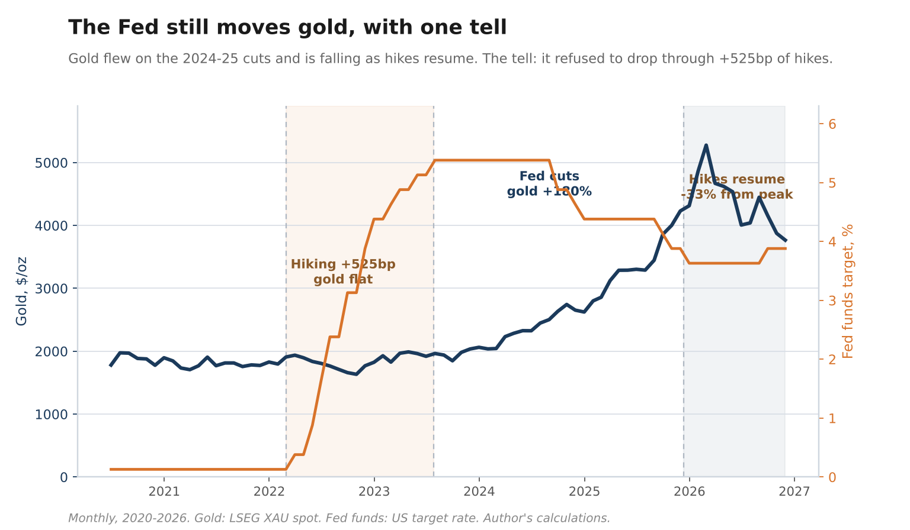

# How I'm Actually Buying the Gold Thesis

### Gold just printed a fresh 2026 low. Here's why I'm buying it on a schedule instead of waiting for a bottom, and the arithmetic behind that.

Gold is at $3,670 as I write on November 19, a fresh 2026 low. It is down 32% from January's peak and 16% from where it sat when I last wrote in September. A few readers asked whether that breaks the thesis. It doesn't, and this post is about what I'm doing with the weakness instead.

**The short version**

- The floor under gold was never a price. It is the pace of central-bank buying, and that pace hit 321 tonnes in Q3, up 42% year on year. A lower spot price doesn't touch it.
- A thesis with no price target can't tell you the day to buy. Dollar-cost averaging fits that shape: fixed dollars on a fixed schedule, more shares when the price is down.
- The math is small and real. DCA gives you the harmonic mean of your purchase prices, about 1% under the simple average in a volatile year. It does nothing for the risk I picked the wrong vehicle, and price is still not a break condition.
- I hold Wheaton Precious Metals and add on a fixed monthly schedule. The break conditions and where they stand are at the bottom.

## The floor is a flow, not a price

$3,741 looks like a problem for a "rising floor" thesis until you remember what the floor is. In [June](#) and [September](#) I argued it was never a line on the chart. It is the pace of price-insensitive central-bank buying, which is a flow measured in tonnes per quarter, not a level in dollars.

That flow is intact. Central banks bought 321 tonnes in Q3, above Q2's 296 and well above the five-year average of 227, taking the year to 675 tonnes, 6% ahead of last year. The TIC data shows the same institutions selling Treasuries to pay for it. None of that moved when the price fell. What fell is the thing the financial layer controls: the ETFs and macro funds that set the week-to-week price marked gold down, while the structural bid kept accumulating underneath.

*Quarterly central-bank net purchases. After a soft Q1 (since revised down to 57t), buying ran 296t and 321t, above the 227t five-year average. Source: WGC Gold Demand Trends Q3 2026.*

So "where is the floor" is the wrong question. The floor is 321 tonnes a quarter of demand that doesn't care about the price, and it is still there at $3,670.

## What's pushing the price down

The price above that floor is set by rates, and rates are moving the wrong way for gold. The Fed resumed hiking in September, lifting the funds rate to 3.88%. The market has December's hike all but priced and leans toward 4.5% to 4.75% by mid-2027. The 10-year Treasury yield is back near 5% and the 30-year near 5.4%, not far off their early-October highs around 5.35% and 5.73%. Higher rates raise the cost of holding something that yields nothing, and the financial layer sells gold on exactly that. The WGC pinned October's drop on the same causes: "Fed rate-path repricing, speculative de-grossing," and a rotation into bonds.

I'm not going to tell you rates stopped mattering. They move the price, and right now they're moving it down. The honest version is narrower, and it's in the data. Through the fastest hiking cycle in forty years, the 525 basis points from early 2022 to mid-2023, gold didn't fall. It went from $1,801 to about $1,950, flat, when the old rate-to-gold relationship said it should have dropped hard. The explosive move came afterward, on the cuts, which the old relationship explains fine. The structural bid doesn't override rates. It stopped letting gold fall when rates said it should.

*Gold versus the fed funds target, 2020–2026. Gold held flat through the 2022–23 hiking cycle (+525bp), rose on the 2024–25 cuts, and is falling as hikes resume. Source: LSEG XAU spot, US fed funds target; author's calculations.*

That is the whole reason I can average into rate-driven weakness without flinching. The dip is caused by the layer I expect to be noisy. The floor is the layer I'm betting on, and it's still buying.

## You can't limit-order a floor you won't price

Both prior posts refused a price target, on purpose. Gold has no cash flows, so every target I've seen is someone backing into a number from a monetary ratio and calling it precision. If I can't tell you whether gold bottoms at $3,857 or $3,400, I can't tell you the single day to buy. A limit order needs a level. I don't have one. What's left is to buy a fixed amount on a fixed date and let the schedule set the entry.

## The arithmetic

Dollar-cost averaging means investing the same dollar amount on a schedule regardless of price. The fixed dollar buys more shares when the price is low and fewer when it's high.

Here's $1,000 a month into WPM across four months of the kind of swing it actually produces.

| Month | WPM price | $1,000 buys |
|---|---|---|
| 1 | $130 | 7.69 sh |
| 2 | $110 | 9.09 sh |
| 3 | $100 | 10.00 sh |
| 4 | $120 | 8.33 sh |

You put in $4,000 and own 35.12 shares, a cost basis of $4,000 ÷ 35.12 = $113.91. The simple average of the four prices is $115.00. You came in $1.09 under, about 1%.

That gap is the harmonic mean of the prices you paid, which leans toward the lows because that's where the fixed dollars bought the most shares. It sits at or below the simple average every time, and the two are equal only if the price never moves. More volatility, bigger gap, so WPM's swings make it larger than it would be on a sleepy stock. Over a full year it's worth maybe 1% to 3% on the cost basis. A tailwind on the entry, not an edge on the thesis.

One caution on what the arithmetic proves. The harmonic mean is a fact about the prices I paid. It is not a claim that spreading the money out beats putting it all in today, which depends on what gold does next.

## Where DCA helps, and where it doesn't

DCA is a confession that I can't time the bottom. If I knew gold ran straight up from here, a lump sum today would beat it, and historically lump sum beats DCA more often than not, because markets rise more than they fall. DCA earns its keep when the price chops or falls before it recovers, which is close to where the WGC's own floor framework puts us: of its three conditions for an interim bottom, two are in place and the third, a washout in speculative positioning, is not. They think there may be lower to go first. That's the environment averaging in is built for.

It smooths the price I pay. It does nothing about whether I bought the right thing. Everything in the first post about owning the streamer still applies: WPM carries its mining partners' execution risk, a disruption at Antamina, a partner default, a shift in capital allocation under new management. Spreading my buys across four months dilutes when I buy, not what I bought.

And price is not a break condition. The break conditions belong to the thesis, and the last post named four. Here's where they stand.

## The break conditions, checked

Carried forward from [September](#), graded as written.

| Watch item (set Sep 8, 2026) | Breaks the thesis if | Status as of Nov 18, 2026 |
|---|---|---|
| Q3 central-bank demand | Q3 fell back toward Q1's revised 57t instead of holding near Q2 | **Held.** Q3 = 321t, above Q2's 296t; y-t-d 675t, +6% y/y. |
| Treasury long-end buybacks | the Nov refunding scaled long-end operations back toward the old $2bn (fiscal stress easing) | **Confirmed the other way.** The Nov 4 refunding raised the quarter's liquidity-support envelope to $70bn from $38bn, and the schedule lifts the long-end per-operation cap to $6bn. |
| The 38% reserve-funding metric | the next WGC survey shows a material rise in central banks funding gold by selling other reserves | **Open.** No new survey since the 2026 edition; next read mid-2027. |
| China TIC trajectory | China halts its Treasury rundown or the PBoC stops adding gold | **Not breaking.** China's Treasury holdings fell $109bn year on year to August; the PBoC added 26t in October, its 24th straight month. |

One correction to log: my September post put Q2 demand at 289t. The WGC's Q3 report revised it to 296t. Same direction, updated number.

Three of the four are pointing the thesis's way and one is waiting on data. None has broken. DCA is a way to act on conviction the data still supports, and if a checkpoint breaks I stop the schedule regardless of how cheap the stock looks.

## The close

I still can't tell you where the floor is in dollars, because it isn't a dollar figure. It's 321 tonnes a quarter, and it's still buying. A price I won't name isn't a price I can wait for. So I'm not waiting. I'm buying the same slice on the same day every month, and letting the schedule do the part I can't.

---

**Disclosure.** I hold a position in Wheaton Precious Metals and add to it on a fixed monthly schedule. This is for information, not investment advice. Dollar-cost averaging reduces the impact of entry timing; it does not reduce the risk of the position, does not beat a lump sum in a rising market, and does not guarantee a profit.

**Sources.** Central-bank demand and the five-year average: World Gold Council, Gold Demand Trends Q3 2026, November 3, 2026 (Q1 revised to 57t, Q2 296t, Q3 321t, y-t-d 675t). Floor framework and the "rate-path repricing" attribution: WGC, "Gold Market Commentary: Where floor art thou?", November 5, 2026. Treasury buybacks: US Treasury Quarterly Refunding Statements, August 5, 2026 (sb0590, "up to $38 billion… for liquidity support") and November 4, 2026 (sb0678, "up to $70 billion"); "Treasury Announces Increased Sizes of Nominal Long-End Liquidity Support Buybacks," August 19, 2026 (sb0607, "$2 billion per operation will be at least $4 billion"); Tentative Schedule of Treasury Buyback Operations, November 2026 Quarterly Refunding ($6 billion long-end per-operation maximum). China Treasury holdings: US Treasury TIC Table 5 (to August 2026). PBoC: WGC China update, November 17, 2026. Treasury yields: CNBC/Tradeweb, November 18, 2026; early-October highs (about 5.35% and 5.73%) and the expected Fed path: CNBC, CME FedWatch, November 2026. Gold and fed funds history for the hiking-cycle figures: LSEG XAU spot and the US fed funds target rate; author's calculations. Prices: COMEX front-month gold about $3,670 (November 19, 2026); WPM about $117 (NYSE). Gold/silver and WPM relative move: silver ~$58 (mid-July) to ~$47 (November) per GoldSilver and Investorideas; WPM production and Antamina from WPM Q3 2026 results, November 2026.
